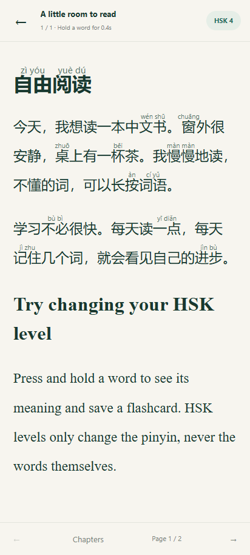
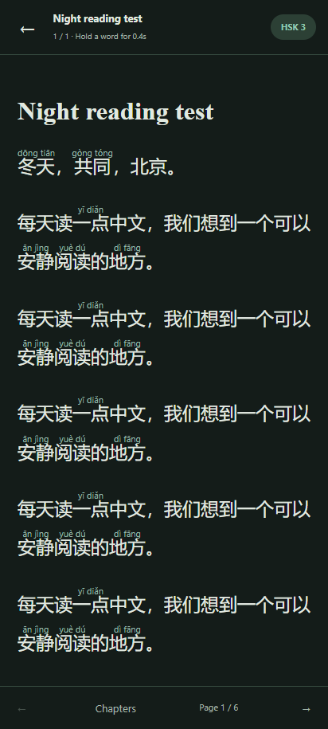

<p align="center"></p>

# OpenChinese 自由

An offline Android EPUB reader for Chinese, with adaptive HSK pinyin, an included Chinese–English dictionary and personal flashcards.

**Read freely. Learn at your own pace.**

**Current version: 0.1.5-alpha · Android 8.0+ · English interface · GPLv3**

OpenChinese is in active alpha development. HSK coverage and word segmentation still need real-world feedback. It uses deterministic word-frequency segmentation with explicit reading-construction rules. Ambiguous compounds, names and polyphonic readings can still need correction.

## New in v0.1.5-alpha

- **Whole-word HSK filtering:** lower-level words hide pinyin; selected-level, higher-level and genuine non-HSK words retain it. Raising the threshold never changes segmentation or adds annotations.
- Improved segmentation using fixed word frequencies, with tested reading-construction boundaries such as 看 / 中文 / 书 and improved 不 / 知道 segmentation.
- All dictionary pronunciation/sense pairs are preserved. 姆 now defaults to mǔ, ordinary readings replace unrelated surname defaults, and alternative readings can be chosen for flashcards.
- 第一 and Chinese number forms receive clearly labelled estimated classifications instead of remaining unclassified.
- Words spanning EPUB inline emphasis stay selectable as whole words; explicit line breaks remain boundaries.
- Nineteen engine regression groups, including the screenshot examples, and five browser suites pass. The APK has not yet been verified on a physical Android device.

See the [release notes](docs/releases/v0.1.5-alpha.md) and [Android test checklist](docs/TEST-ON-ANDROID.txt).

## What you can do

- Import unencrypted EPUB books into a private on-device library.
- Read with pinyin adapted to your HSK level. The selected level stays visible; earlier levels are hidden. Genuine non-HSK words keep their dictionary reading.
- Change HSK level without changing word boundaries. Supplemented and estimated classifications are identified in the dictionary.
- Hold a whole word to open its English definition and save a flashcard, context and personal note, including when its pinyin is hidden. Choose another dictionary pronunciation and its matching meaning before saving when needed.
- Choose the hold duration: **0.3 / 0.4 / 0.5 / 0.7 / 1 second**, with **0.4 seconds as the default**.
- Turn pages with horizontal swipes, side taps or the footer arrows; choose chapters and resume your reading position.
- Use dark mode across the library, book pages, dictionary and flashcards.
- Review flashcards with Again / Good, and export/import JSON backups.
- Delete imported books while retaining your flashcards and original EPUB files.
- Read offline with no account, analytics or Android network permission.

The app includes **198,654 indexed CC-CEDICT headwords** and **10,896 HSK written forms**, organised into separate HSK1–6 and HSK7–9 files. HSK7–9 is one combined band.

## Install

Open the [**Releases** section](https://github.com/Caoyangzi666/OpenChinese/releases) and download the APK attached to the latest alpha release. An APK is the installable Android app; the source ZIP contains the project for developers.

Open the APK on an Android 8.0+ device with an up-to-date Android System WebView. For an update, install over the existing official alpha app. **Do not uninstall or clear app storage if you want to keep your library and flashcards.** Export a flashcard backup first.

Launch the app, try the included sample, then import your own EPUB. In **Settings**, choose your HSK level, word-press duration and dark mode. Reader preferences are also available while a book is open.

Community builds signed with a different key cannot update the official APK in place. Keep a backup before changing builds.

## Screenshots

 

## HSK behaviour

Segmentation uses the full dictionary and HSK vocabulary before applying the selected level:

1. Segment Chinese text using a fixed word-frequency graph, independently of the selected HSK level.
2. Classify whole tokens and their Simplified/Traditional aliases.
3. Show pinyin when the token's level is at least the selected level, or when it is genuinely outside HSK.

At HSK4, HSK1–3 pinyin is hidden; HSK4 and above remain visible. Raising the level can only remove annotations, never introduce new ones or change token boundaries.

The supplied syllabus omits some familiar forms. Explicit supplements and estimates for selected productive grammatical patterns are distinguished from official whole-word entries. They do not classify every unknown compound by its characters.

## Development

The included data is ready to use; no private dictionary files are needed to build the app.

Open the root folder in Android Studio with **JDK 17**, **Android SDK 35** and **Gradle 8.9**. The project uses Android Gradle Plugin 8.7.3. A Gradle wrapper is not included. Configure Android Studio to use a local Gradle 8.9 distribution, or use `gradle assembleDebug` with Gradle 8.9 installed. See [development instructions](docs/DEVELOPMENT.md) for signing, a Windows build-tools alternative and tests.

```text
app/src/main/java/       Android bridge and EPUB importer
app/src/main/assets/web/ Reader interface, gestures and Chinese engine
app/src/main/assets/data/ Included dictionary and separate HSK vocabularies
tests/                  Engine, browser and native Java regression checks
branding/               Original 自由 SVG and PNG logo
docs/                   Testing, development and release notes
```

See [manual testing and known limitations](docs/TESTING.md). The previous alpha was used on a physical Android phone; version 0.1.5 changes have desktop/browser checks and a verified APK signature, but still require device confirmation.

## Contributing

Bug reports and improvements are welcome. For HSK issues, include the exact word, selected level, expected level and a short passage you are permitted to share. See [CONTRIBUTING.md](CONTRIBUTING.md).

## License and data credits

Original application code and project artwork: **GNU GPL version 3 only**, with no warranty. See [LICENSE](LICENSE) and [NOTICE](NOTICE).

The included data retains its own licenses:

- **CC-CEDICT:** CC BY-SA 4.0.
- **Jieba segmentation frequencies and pypinyin default readings:** MIT (notices in `licenses/`).
- **HSK vocabulary:** CC BY 4.0, from chelsea6502/hsk-2025-data, attributed there to chinesetest.cn.

See [DATA-NOTICES.txt](DATA-NOTICES.txt) for source links, attribution and transformations. These data licenses are not replaced by the application's GPL license.
